# Build Protocol v0.1 (DRAFT — 2026-10-07)

The typed contract for predictable software builds: `[problem | spec] → documentation → code → evidence`.
One protocol, many clients: the AImy software-builder module, Forge2 Studio's Generate stage, open-code, and any future builder.

Status: **draft for review.** Nothing here is implemented; this document exists so the implementations converge instead of drifting.

## 1. Why a protocol, not a module

A module is code that runs inside one host. A protocol is a contract many hosts can speak. Kimler's goal — AImy instances, Forge2, and open-code all building software through the *same* predictable process — requires the contract first. The implementations (AImy module, Forge2 integration, open-code adapter) are then conformance work, not design work.

## 2. Principles

1. **Contract-first.** Every stage consumes a typed input and produces a typed output. No stage reads another stage's mind; no free-text handoffs between stages.
2. **Evidence-backed.** Every factual claim a stage makes (a requirement is satisfied, a gate passed, code matches spec) carries evidence or is labeled unverified. Borrowed from AImy's honesty layer: badges are `verified` / `unverified` / `failed`, derived from the ledger, never asserted.
3. **Deterministic where it matters.** Spec → documentation is derivation, not improvisation (cf. Forge2 Paper 3: specification-derived architecture). Nondeterminism (model generation) is confined to the code stage and fenced by verification.
4. **Fail-closed.** A stage that cannot verify its output does not pass it on. A failed gate is a finding, never silently repaired (Forge2's standing rule).
5. **Versioned.** The protocol is `build-protocol/0.1`. Clients declare the version they speak. Breaking changes bump the version; the old version keeps working.

## 3. The pipeline

```mermaid
%%{init: {"theme": "base", "themeVariables": {"primaryColor": "#1a1a2e", "primaryTextColor": "#e0e0e0", "lineColor": "#475569", "fontSize": "14px", "edgeLabelBackground": "transparent"}}}%%
flowchart LR
  classDef input fill:#1e293b,stroke:#00e5ff,stroke-width:0.75px,color:#00e5ff,filter:none,text-shadow:none
  classDef contract fill:#0f172a,stroke:#a855f7,stroke-width:0.75px,color:#a855f7,filter:none,text-shadow:none
  classDef docs fill:#1a0f2e,stroke:#22d3ee,stroke-width:0.75px,color:#22d3ee,filter:none,text-shadow:none
  classDef code fill:#0a1628,stroke:#34d399,stroke-width:0.75px,color:#34d399,filter:none,text-shadow:none
  classDef bundle fill:#111827,stroke:#f59e0b,stroke-width:0.75px,color:#f59e0b,filter:none,text-shadow:none

  A["problem or<br/>spec"]:::input -->|"spec.validate"| B["spec<br/>(contract)"]:::contract
  B -->|"docs.derive"| C["docs<br/>(arch)"]:::docs
  C -->|"code.generate"| D["code<br/>(generated)"]:::code
  D -->|"evidence.seal"| E["bundle<br/>(sealed)"]:::bundle

  linkStyle default stroke:#475569,stroke-width:0.75px
```

### Stage 1 — `spec.validate`: problem → contract

- **Input:** a problem statement (free text) or a spec document (typed).
- **Output:** a `Spec` — typed, with requirements, constraints, acceptance criteria, and explicit non-goals. Every requirement has an id; every acceptance criterion is machine-checkable or labeled `human-check`.
- **Rules:** ambiguity is resolved by asking, not by guessing. An unresolvable ambiguity fails the stage with the question attached — it does not guess forward.
- **Evidence:** the spec itself is evidence for everything downstream; it is hashed and pinned (cf. AImy's PinRegistry — byte-identity across transforms).

### Stage 2 — `docs.derive`: contract → documentation

- **Input:** a validated `Spec`.
- **Output:** architecture/design documentation derived from the spec: component boundaries, data flows, interface definitions, dependency direction.
- **Rules:** derivation, not invention. Every doc section cites the spec requirement(s) it serves. A section with no parent requirement is flagged, not shipped.
- **Evidence:** each doc claim links to its spec requirement id (verified) or is marked unverified.

### Stage 3 — `code.generate`: documentation → code

- **Input:** derived docs + the pinned spec.
- **Output:** source code, contract-first: interfaces/types before implementations.
- **Rules:** this is the only stage where model nondeterminism is allowed, and its output is *always* tre