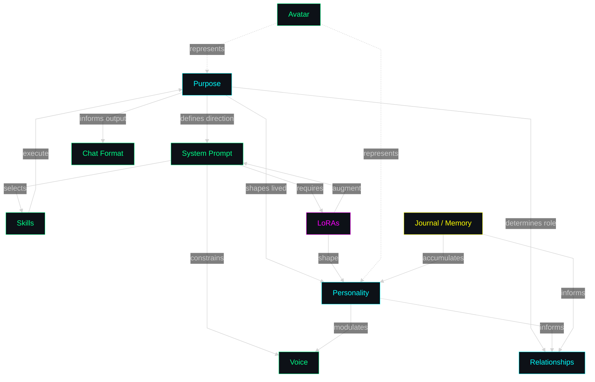

# Entity Charter — Design Document

**Date:** 2026-10-12  
**Status:** Early concept. Not yet scoped for implementation.  
**Phase:** Later (after Phase I document harness, after bundle registry).

## What Is an Entity?

An entity is the complete interaction element the user collaborates with.
AImy is the first entity. There will be others.

An entity is composed of:

- **Purpose** — what it is *for*. The direction the whole configuration points toward. Decided first; everything else follows from it.
- **System prompt** — the core instructions, identity, behavioral constraints
- **Voice** — how it talks (narrate capability, TTS voice, expression tags)
- **Skills** — known out-of-the-box capabilities
- **LoRAs** — associated adapters (communication, product, personality, domain)
- **Personality** — purpose (lived), traits, ASC dials, relational patterns. Purpose is the direction; traits are the shape. Personality is where purpose gets *experienced* by the entity, not just configured.
- **Avatar** — visual representation
- **Chat format** — how it structures responses (markdown style, block sequencing)

All of these together make up the actual entity the user interacts with.
Change any of them and you change who you're talking to.

### Entity Composition Diagram

  
GRAPH LEGEND

  

    
    Core — Purpose, Personality, Relationships, Chat Format
  

  

    
    Prompt — System Prompt, Voice, Skills, Avatar
  

  

    
    LoRA — Adapters (communication, product, personality, domain)
  

  

    
    Memory — Journal / Memory
  

**Reading the diagram:**

- **Purpose** is the apex. It points at System Prompt, Personality, Relationships, and Chat Format. Everything else is downstream.
- **System Prompt** is the first consequence — it's purpose written as instruction. It constrains Voice, selects Skills, and determines which LoRAs are needed.
- **LoRAs** flow *back up* to System Prompt and Personality. They don't create the entity; they *shape* the entity that purpose already defined.
- **Personality** is where Purpose gets *lived*. It modulates Voice and informs Relationships. The Journal feeds into Personality over time — that's how an entity becomes *specific* instead of just *configured*.
- **Skills**