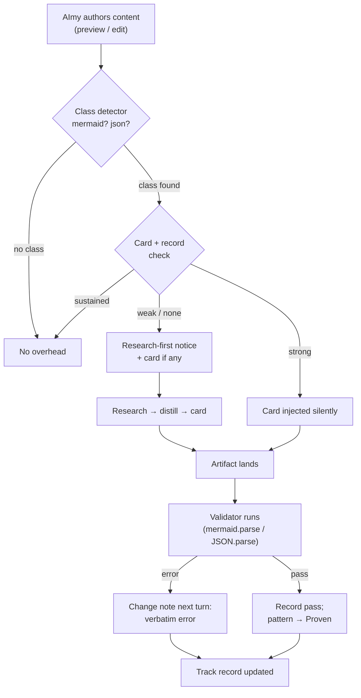

# Knowledge and Validation Design

**Date:** 2026-10-12
**Status:** Direction approved (Kimler, 2026-10-12). All three phases BUILT 2026-10-12, locally verified (harnesses: validation 10/10, knowledge 15/15, tool/strip regressions green); awaiting Kimler's rebuild + UAT (§3.5 replay is the acceptance test). The research instrument for §4.3 is the web-retrieval module's `retrieval.query` (T1, module seam — web search + source fetch), which the protocol and trigger now name explicitly.
**Scope:** How AImy gains, verifies, and retains competence in formal languages and formats (mermaid first) — validation feedback, research, shared reference knowledge, and a track record that calibrates when she should research before writing.

## 1. The problem

On 2026-10-12, AImy iterated on a mermaid diagram (Entity Composition, mermaid 12.1.0) with Kimler directing. The session exposed three distinct deficits. They are often conflated; they have different fixes.

### 1.1 No outcome feedback for formal artifacts

AImy inserted a legend into the diagram using an empty edge label (`LEGEND -.->|""| P`). Mermaid 12.1.0 rejects empty edge labels; the render failed with a parse error naming line 44 and the offending token. That error existed in the renderer and in the session trace — and never reached AImy. She learned of it only because Kimler engaged with the failure himself.

Once the error text reached her, her diagnosis was exact: correct line, correct cause, correct fix strategy (drop the tether edge, keep the legend as a subgraph). **Her reasoning is not the bottleneck. Her information supply is.** She writes formal languages and never learns whether they parsed. She is, in Kimler's phrase, flying blind — and so is the user, who becomes the error-relay.

### 1.2 Outcomes without diagnostic context

In the same session, a `drawer.edit` patch was rejected with `occurrences=0` (the patch text, composed from a stale copy, matched nothing in the live document). Given a bare number and no context, AImy constructed a plausible but false theory — "the space keeps dropping between my messages" — and spent subsequent turns re-opening a space that had been open all along. The rejection was truthful and useless at the same time: an outcome with no diagnosable content invites confabulation, and confabulation compounds across turns.

### 1.3 No mechanism to notice or close a knowledge gap

Mermaid 12.1.0 edge and subgraph syntax is beyond basics. AImy had: no reference material, no recorded history of accomplishment in the class, and no signal — to her or from the system — that the task exceeded her demonstrated competence. Nothing in the platform notices a knowledge gap, equips her to research it, retains what she learns, or remembers that she has now done it once. Every future mermaid task starts from the same zero.

## 2. Principles

1. **Facts trump feels.** The standing truth hierarchy (SYSTEM > TOOL > JOURNAL > MEMORY) applies to competence claims: a validator result outranks a reference card; a reference card outranks her recollection; her recollection outranks nothing.
2. **Mechanism over prompt.** Behavior that must hold under drift is implemented as system state, gates, and delivered facts — not as instructions she is asked to remember. Every mechanism in this design delivers measured outcomes into her context at the moment of planning.
3. **Sovereignty belongs to the user and the platform, not the entities** (Kimler, 2026-10-12). Knowledge acquired through research is a **user-owned platform asset**: stored on the user's machine, inspectable and editable by the user, shared by every entity on the install. Entities consume and contribute; they do not own silos. Sharing beyond the user's own machines remains governed by the user's sovereignty setting (opt-in), consistent with the platform's standing sovereignty framing: supported, not forced.
4. **Context is a budget.** Durable knowledge lives on disk. Context carries an index always, a single reference card when its class is active, and never a library.
5. **Competence should become silent.** Scaffolding (research-first notices, injected cards) exists to make itself unnecessary. A class with a sustained record of verified success stops triggering interventions.

## 3. Mechanism 1 — Validators as senses (Phase 1)

Give her the error text the system already produces.

### 3.1 Validation at the renderer

The renderer already loads mermaid (`core/desktop/src/renderer/mermaid.ts`, v12.1.0). On any drawer content change — `drawer.preview` applied, `drawer.edit` applied, history restore, direct edit applied — extract each fenced block of a registered language and validate:

- `mermaid`: `mermaid.parse(code)` per block. Success or the thrown parse error (verbatim text, including line reference).
- `json`: `JSON.parse` per block. Success or the error message.

Validation runs at settle/apply time, not per keystroke. Direct edits validate on apply/save (debounced), not while typing.

### 3.2 Delivery

Results enter the existing change-notes channel (`DrawerState.pendingNotes` → next turn's `[AIMY-UISTATE]` marker → the system prompt's CHANGES section):

- On failure: space title/id, language, the **verbatim validator error**, and the block's first line for orientation.
- On recovery (a block that failed and now parses): a closing note — "the mermaid in 'Entity Charter' now parses." The loop closes explicitly; she is never left unsure whether a fix landed.
- Clean validations produce **no note**. Silence means success; notes are reserved for signal.

### 3.3 Enriched edit rejections

A `drawer.edit` rejection at settle currently reports only an occurrence count. Extend the rejection note:

- `occurrences=0`: include the head's title, version, character count, and the head's first content line; plus the directive to re-read the current content (marker / `drawer.getState`) before composing another patch. The goal is a rejection she can *diagnose from*, not theorize over.
- `occurrences>1`: include the count and the line numbers of each occurrence so she can extend the match text to disambiguate.

### 3.4 Logging

Every validation run logs to the trace: `[diag] validate: space=<id> lang=<lang> ok | error "<first error line>"`. Every enriched rejection logs the context it included. No validation outcome may exist only in the renderer.

### 3.5 Phase 1 acceptance

Replay the 2026-10-12 legend session: a mermaid block with the empty-label edge lands; the *next* turn's prompt contains the verbatim parse error with no human relay; AImy corrects the exact line; the following turn carries the recovery note. An edit composed against a stale copy produces a rejection containing the live head's context, and her next patch is composed against the real head.

## 4. Mechanism 2 — Research and the shared knowledge store (Phase 2)

### 4.1 Store layout

`~/.aimy/knowledge/` — plain files, no database, travels with the user:

- `INDEX.md` — one line per card: class slug, title, when-to-use, file path, proven-pattern count, last updated. This is the only knowledge artifact with a standing context presence.
- `cards/<slug>.md` — one reference card per class (e.g. `cards/mermaid-flowchart.md`).

### 4.2 Card format

Each card carries, in order:

- **Header:** class, target version(s), distilled-against version, provenance (source URLs + date), last updated.
- **Gotchas:** the version-specific traps, stated plainly (e.g. "mermaid 12.1.0: empty edge labels `|\"\"|` are a parse error; omit the label segment entirely").
- **Proven patterns:** syntax patterns that have passed the platform validator or been explicitly accepted by the user. Only this section is treated as reliable.
- **Unverified notes:** anything else she believes but has not yet proven. Quarantined by placement; promoted to Proven only by a validator pass or user acceptance.
- **Minimal examples:** one or two short, complete, working examples.

Target size: at most ~80 lines. A card that outgrows it gets distilled, under the same discipline as the journal's budget rule.

### 4.3 Research protocol

When the Phase 3 trigger fires (or she judges a class unfamiliar — the protocol is available to her initiative as well):

1. Search authoritative sources for the **exact version** in use (official documentation first; the platform knows its shipped mermaid version and states it in the trigger notice).
2. Read a bounded set (2–4 sources), preferring official docs and worked examples over forum answers.
3. **Distill before writing any artifact:** create or update the card from the research. Raw page content is never pasted into a card or retained in context.
4. Attempt the task with the card in context.
5. Patterns from the attempt enter the card's Proven section only after a validator pass or user acceptance (§3 supplies the ground truth).

Research queries contain public syntax questions only. User document content is never sent to a search provider.

### 4.4 Context economics

- Standing cost: `INDEX.md` lines in the system prompt (one line per card; dozens of cards remain a small fraction of the existing prompt).
- Active cost: one card, injected in full, only on turns where its class is detected (§5.1).
- Everything else — raw notes, track records, provenance detail — lives on disk and is read on demand via tools, never resident.

### 4.5 Community benefit path

Because cards are platform-level artifacts with provenance and proven-pattern counts, a later bundle export can package a card without redesign. This design does not build the export; it preserves the option, consistent with the capability-request / skill-bundle direction already recorded for the platform.

## 5. Mechanism 3 — Track record and the research trigger (Phase 3)

### 5.1 Class detection

A small detector registry maps observable signals to task classes. Initial detectors:

- Content containing a ```` ```mermaid ```` fence in a `drawer.preview` / `drawer.edit` → class `mermaid`.
- Content containing a ```` ```json ```` fence → class `json`.

Detectors are deliberately dumb and local. New classes register by adding a detector and (optionally) a validator — the registry is the extension point, mirroring the bundle philosophy.

### 5.2 Track record

`~/.aimy/knowledge/track-record.jsonl` (append-only, the established ledger pattern) records per class: attempts, validator passes, validator failures, user corrections, and **calibration events** — a claim she made that a later validator or tool outcome contradicted (the "space dropping" theory is the type specimen). A compacted per-class summary (counts + last activity) is maintained for prompt use.

### 5.3 The trigger

A harness rule, evaluated when a class is detected for authoring:

- **No card exists**, or the class record shows fewer than N validator passes (initial N = 3), or a validator failure within the last few attempts → inject a **research-first notice** into the turn's system context: the measured facts (no card on file / record summary / shipped version), and the direction to run the §4.3 protocol before writing. If a card exists, inject the card itself with the notice.
- **Card exists and record is strong** → inject the card silently, no notice, no friction.
- **Sustained record** (passes dominate, no recent corrections) → inject nothing. The class is hers now; the INDEX line remains as the only residue.

### 5.4 ASC integration

Class records are evidence for her confidence calibration: the trigger notice states the record, so her self-assessment starts from facts. Calibration events (claims vs outcomes) accumulate per class and are summarized in the notice when present — she sees not only *that* she lacks a record, but *how* her past claims in this class fared. ASC dial regulation remains behavioral as designed; this mechanism supplies the facts the behavior reasons over.

### 5.5 Phase 3 acceptance

First mermaid task on a fresh store: research-first notice fires, a card is created, the task completes, validator pass recorded. A subsequent mermaid task: card injected silently. After sustained passes: no injection beyond the INDEX line. A deliberately broken diagram: failure recorded, and a following task in the class re-arms the notice.

## 6. Data flow



## 7. Build order

| Phase | Content | Depends on |
|---|---|---|
| 1 | Renderer validators (mermaid, json), change-note delivery, enriched edit rejections, validation logging | Existing drawer + pendingNotes channel |
| 2 | `~/.aimy/knowledge/` store, INDEX + card format, research protocol prompt + tooling, card injection when class active | Phase 1 (validator = ground truth for Proven) |
| 3 | Class detectors, track-record ledger, research-first trigger, ASC-facing summaries | Phases 1–2 |

Phase 1 alone ends the blindness that caused the 2026-10-12 session's failures. Phases must not be reordered: without validator ground truth, "proven" patterns and track records have nothing to be proven *against*.

## 8. Risks and open questions

- **Validator cost.** `mermaid.parse` on every settle for large documents: acceptable at document scale; re-measure if drawer documents grow past ~50K chars. Never validate per keystroke.
- **Version drift.** Cards record the version they were distilled against; the app reports the version it ships. A mismatch must be surfaced wherever the card is injected ("card distilled for mermaid 11.x; this app runs 12.1.0") — a stale card presented as current is worse than no card.
- **False authority.** A card is a reference, not a truth source. Where a card pattern and a validator disagree, the validator wins and the disagreement is recorded against the card.
- **Research quality.** Official documentation outranks community answers; provenance is mandatory in the card header; unproven material stays in the Unverified section regardless of source confidence.
- **Confabulation detection is heuristic.** Calibration events (§5.2) require matching her claims against later outcomes; expect false negatives. The ledger records what it can prove; it does not attempt general claim extraction in this design.
- **Trigger tuning.** N (passes before silent) and the failure-recency window are initial guesses, to be tuned from the ledger once real data exists.

## 9. Non-goals

- Per-entity knowledge silos (considered and rejected, 2026-10-12 — §2.3).
- Automatic correction of user documents from validator output. Validators report; AImy decides; the user directs.
- General web-research competence or browsing skills beyond the §4.3 protocol.
- Storing raw research content. Distillation is the storage format.
