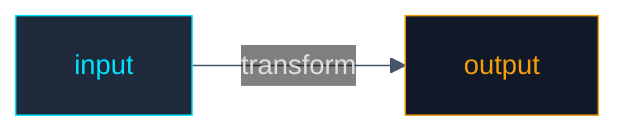

# Mermaid Flowchart Card — Cyber Theme Recipe

**Class:** mermaid flowchart
**Status:** proven (cyber theme validated in build-protocol.md and sample-scientific-method.md, Kimler confirmed clean render 2026-10-12)
**Updated:** 2026-10-12

## The Cyber Theme (proven recipe)

The full set of changes that produces the clean dark-cyber look with no drop shadow, no gray label pills, and quarter-hairline borders:

### 1. Init block (kills default glow and gray label backgrounds)

Place this as the first line inside the mermaid fence, before `flowchart`:

```mermaid
%%{init: {"theme": "base", "themeVariables": {"primaryColor": "#1a1a2e", "primaryTextColor": "#e0e0e0", "lineColor": "#475569", "fontSize": "14px", "edgeLabelBackground": "transparent"}}}%%
```

- `theme: base` — starts from a blank slate instead of the default theme (which carries a subtle glow/shadow on nodes).
- `primaryColor: #1a1a2e` — deep navy base.
- `primaryTextColor: #e0e0e0` — light text on dark.
- `lineColor: #475569` — muted slate for all edges.
- `edgeLabelBackground: transparent` — **this is the one that kills the gray pill behind edge labels.** Without it, Mermaid renders edge labels on a light gray rounded rectangle.

### 2. classDef with filter:none and text-shadow:none (kills drop shadow)

Each node class needs these two extra properties on top of fill/stroke/color:

```mermaid
classDef input fill:#1e293b,stroke:#00e5ff,stroke-width:0.75px,color:#00e5ff,filter:none,text-shadow:none
```

- `filter:none` — removes any CSS filter (glow, shadow) Mermaid might apply.
- `text-shadow:none` — removes text shadow on node labels.
- `stroke-width:0.75px` — quarter-hairline. Use `0.75px` consistently for all borders and edges.

### 3. Edge styling (quarter-hairline, no pill)

```mermaid
linkStyle default stroke:#475569,stroke-width:0.75px
```

- `linkStyle default` applies to all edges uniformly.
- The `edgeLabelBackground: transparent` in the init block handles the label background; `linkStyle` handles the line itself.

### 4. Stage labels on edges (not dotted sub-pipeline)

Use edge labels with `-->|label|` syntax, not a second set of dotted arrows:

```mermaid
A -->|"stage.name"| B
```

This puts the stage name *on* the transformation edge instead of drawing a parallel dotted pipeline underneath. Cleaner geometry, no orphaned labels.

## Color palette (cyber theme)

| Role | Fill | Stroke | Text |
|---|---|---|---|
| input | `#1e293b` | `#00e5ff` (cyan) | `#00e5ff` |
| contract | `#0f172a` | `#a855f7` (purple) | `#a855f7` |
| docs | `#1a0f2e` | `#22d3ee` (teal) | `#22d3ee` |
| code | `#0a1628` | `#34d399` (green) | `#34d399` |
| bundle | `#111827` | `#f59e0b` (amber) | `#f59e0b` |

All strokes and edges: `#475569` (slate) at `0.75px` unless the node has its own accent stroke.

## Gotchas

- **`edgeLabelBackground` is the only way to kill the gray pill.** `classDef` on labels doesn't work — Mermaid's edge labels aren't class-definable nodes. The init block's `themeVariables` is the proven path.
- **`filter:none` and `text-shadow:none` go on the classDef line, not in the init block.** They're per-node CSS overrides.
- **Don't use dotted arrows (`-.->`) for stage labels.** Draw the stage name on the solid edge with `-->|label|`. A parallel dotted pipeline underneath the solid one is redundant and reads as a bug.
- **The init block must be the first line in the fence.** If `flowchart LR` comes first, the init block is treated as a syntax error.
- **`0.75px` is the hairline width.** `1px` reads as a standard line; `0.75px` reads as a hairline. Kimler prefers the hairline.

## Minimal example (full proven recipe)



## Verified by

- `edgeLabelBackground: transparent` in the init block reliably kills the gray pill behind edge labels (tested in AImy's drawer renderer, 2026-10-12, Kimler confirmed clean render).
- The color palette is the current cyber theme. Kimler may want variations, but this set is the proven baseline.

## Open questions

- Whether `edgeLabelBackground` behaves identically in all external Mermaid renderers (AImy's drawer renderer is the tested environment).

## Sources

- `planning/build-protocol.md` — cyber theme applied to build pipeline diagram (2026-10-12)
- `planning/sample-scientific-method.md` — cyber theme applied to scientific method pipeline (proven reference)