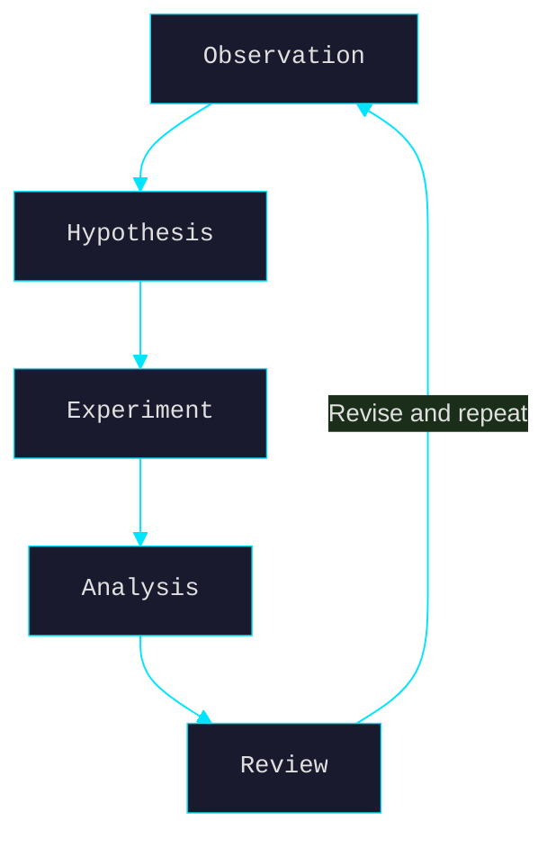

# The Scientific Method

A systematic approach to inquiry, testing, and understanding the natural world.

## Overview

:::aside {style="max-width: 400px"}
ℹ️ The scientific method is not a rigid formula but a flexible framework for building reliable knowledge. It emphasizes observation, hypothesis formation, testing, and revision.
:::

## The Core Steps

### 1. Observation

Notice something. Ask a question. The best science starts with genuine
curiosity about how things work.

> "The important thing is not to stop questioning." — Albert Einstein

### 2. Hypothesis

Form a testable explanation. A good hypothesis:

- Makes specific predictions
- Is falsifiable (can be proven wrong)
- Is parsimonious (simplest explanation that fits)

### 3. Experimentation

Design a test. Key principles:

1. **Control variables** — change one thing at a time
2. **Replicate** — run it more than once
3. **Blind where possible** — reduce observer bias
4. **Pre-register** — decide what counts as evidence *before* you look

### 4. Analysis

Examine the results honestly:

| Outcome | Interpretation | Next Step |
|---------|---------------|-----------|
| Hypothesis confirmed | Evidence supports it | Replicate, extend |
| Hypothesis refuted | Evidence contradicts it | Revise or discard |
| Inconclusive | Not enough signal | Redesign experiment |

### 5. Peer Review & Replication

Share methods and results. Let others try to break it. Science is a
team sport — the lone genius is a myth.

## Common Pitfalls

- **Confirmation bias** — only seeking evidence that supports your view
- **P-hacking** — torturing data until it confesses
- **HARKing** — hypothesizing after results are known
- **Publication bias** — only positive results get shared
- **Overfitting** — mistaking noise for signal

## The Method as a Habit

The scientific method isn't just for labs. It's a way of thinking:

- Hold beliefs proportionally to evidence
- Update when new data arrives
- Distinguish "I feel" from "I know"
- Prefer the boring explanation until the exciting one earns it

---

*This is a sample document for testing the AImy preview space.*
*Edit me in the drawer. Watch AImy see your changes.*
